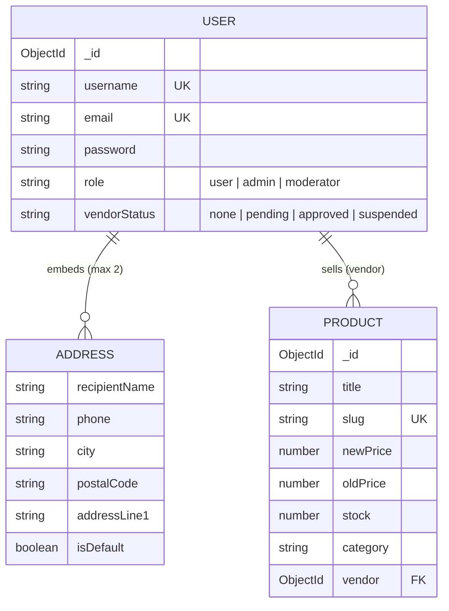

# Architecture

This document describes how Handmade Store is put together and why. For setup instructions see [README.md](./README.md).

## Monorepo layout

```
handmadeStore/
├── handmade-backend/   # Express REST API (Node.js, ES modules)
└── handmade-store/     # React single-page app (Vite)
```

The two folders are independent packages, each with its own `package.json`, `node_modules` and `.env`. They share no code. The only contract between them is the HTTP API.

- The frontend calls the API directly at `VITE_API_BASE_URL` (default `http://localhost:5000`). There is no dev-server proxy.
- Every request is sent with `credentials: 'include'`, so the browser attaches the auth cookie.
- The backend enables CORS for exactly one origin (`http://localhost:5173`) with `credentials: true`, which browsers require before they send cookies cross-origin.
- All API paths live in one place on the frontend (`src/utils/endpoints.js`).

## Data model

MongoDB is accessed through Mongoose. Both models below use `timestamps: true`.

### User (`users` collection)

| Field | Notes |
| --- | --- |
| `username`, `email` | Unique. The email is lowercased and format-validated. |
| `password` | Hashed with bcrypt (cost 12) in a `pre("save")` hook. `select: false` keeps it out of queries by default, and a `toJSON`/`toObject` transform removes it from any serialized output. |
| `fullName`, `phone` | Optional profile data. |
| `role` | `user` / `admin` / `moderator`, default `user`. Platform-level permissions. |
| `vendorStatus` | `none` / `pending` / `approved` / `suspended`, default `none`. |
| `address` | An embedded array of Address subdocuments, validated to at most 2. |

`role` and `vendorStatus` are deliberately separate. `role` answers "what can this account do on the platform?" (customer, moderator, admin). `vendorStatus` tracks the account's lifecycle as a seller: it applies, waits for review, is approved, or is suspended. Any regular user can become a vendor without changing their role, and suspending a seller does not touch their customer account. Both fields are indexed so accounts can be listed by status.

### Address (embedded in User)

`recipientName`, `phone`, `country`, `city`, `postalCode`, `addressLine1`, `isDefault`. Addresses are embedded rather than kept in their own collection because they are always read and written together with their owner and never shared between users. The service layer makes the first address the default and keeps exactly one default when another address is marked as default.

### Product (`product` collection)

The catalog fields are `title`, `description`, `shortDescription`, `newPrice`, `oldPrice`, `stock`, `sold`, `outofstock`, `category`, `tags`, `size`, `code` and `images` (`sliderLandscape`, `gallery`).

- **`vendor`**: a required `ObjectId` reference to `User`, indexed. A product cannot exist without an owner.
- **`slug`**: unique and generated from the title (Cyrillic is transliterated to Latin). A unique index protects it. `saveWithUniqueSlug()` retries with a numeric suffix on a duplicate-key error, which stays correct under concurrent writes, unlike a check-then-save loop.
- **`discount`**: a virtual computed from `oldPrice` and `newPrice` and included in JSON output.
- `category`, `tags` and `code` are lowercased and indexed for filtering.



## Authentication and authorization

**Login and registration.** `POST /users/register` and `POST /users/login` validate the credentials. Passwords are compared with `bcrypt.compare`. The server then signs a JWT whose payload holds only `{ _id, role }` and which expires after 1 hour. The token is set as a cookie:

```js
{ httpOnly: true, sameSite: "lax", secure: NODE_ENV === "production", maxAge: 1h }
```

The response body returns a small user DTO (`_id`, `fullName`, `username`, `role`, `vendorStatus`), never the token.

**Protecting routes.** The `verifyToken(allowedRoles = [])` middleware reads the cookie, verifies the JWT and sets `req.user`. It responds with 401 when the token is missing, invalid or expired, and with 403 when a list of allowed roles is passed and the user's role is not in it.

**Session restore.** On startup `AuthProvider` calls `GET /users/me`. If the cookie is valid, the user DTO is written to auth state. On a 401 the local state is cleared. While this check runs, the provider renders nothing, so the app never flashes the wrong signed-in/signed-out UI. A non-sensitive copy of the profile (`_id`, `fullName`, `username`, `role`) is cached in `localStorage` for display. The token itself is never readable by JavaScript.

**Frontend guards.**

- `ProtectedRoute` redirects anonymous users to `/auth/login` and remembers where they came from in `state.from`. It also accepts an optional `allowedRoles` prop.
- `PublicOnlyRoute` redirects signed-in users away from the login page to `/account/profile`.

Both render an `<Outlet />`, so they wrap groups of routes in `App.jsx`.

## Backend structure

```
src/
├── index.js         # DB connection, CORS, cookie/JSON parsing, routes, error handler
├── routes.js        # mounts the controllers + a JSON 404 catch-all
├── controllers/     # Express routers: HTTP in/out only
├── services/        # database logic, throw errors carrying a statusCode
├── models/          # Mongoose schemas and model-level validation
├── middlewares/     # verifyToken, errorHandler
└── utils/           # JWT/cookie helpers, DTO mappers, slugify, saveWithUniqueSlug
```

- **Controllers** (`productController`, `userController`) are plain `Router()` instances. They read the request, call a service and send the response.
- **Services** (`productServices`, `userServices`) hold the queries and the business rules: filters and sorting, the "top discounted" aggregation, the address limit and default address, the current-password check.
- **Validation** has two layers. Mongoose schema validators cover required fields, lengths, formats and enums. Controllers and services accept only explicitly listed fields (for example `ADDRESS_FIELDS` and `ACCOUNT_FIELDS`), so request bodies are never written to the database as-is.
- **DTOs** (`toUserDTO`, `toUserDetails`) decide exactly which user fields leave the server.
- **Error handling**: the user routes forward errors with `next(err)` to `errorHandler`. It maps Mongoose `ValidationError` to 400 (first message), duplicate keys (`11000`) to 409, and errors carrying a `statusCode` to that status. Anything else becomes a generic 500 message, so internal details are not leaked.

## Frontend structure

**Entry and providers.** `main.jsx` nests `BrowserRouter`, then `AuthProvider`, `ShopProvider`, `WishlistProvider` and `QuickViewProvider`, then `App`.

**Routing** (`App.jsx`, React Router 7):

| Path | Page | Guard |
| --- | --- | --- |
| `/` | Home | - |
| `/products` | Catalog (filters in the query string) | - |
| `/products/:productId/details` | Product details (lazy-loaded) | - |
| `/auth/login` | Login / register (lazy-loaded) | `PublicOnlyRoute` |
| `/account/profile` | Account area | `ProtectedRoute` |
| `*` | 404 | - |

The routes are wrapped in an `ErrorBoundary` with a retry button and a `Suspense` fallback.

**Context stores:**

| Context | Responsibility | Persistence |
| --- | --- | --- |
| `AuthContext` | Current user, `vendorStatus`, login/register, session restore | Profile copy in `localStorage` |
| `ShopContext` | Cart items and quantities, stock checks via `POST /products/check`, subtotal and count | Item ids and quantities in `localStorage` |
| `WishlistContext` | Toggling and counting wishlist items | `localStorage` |
| `QuickViewContext` | Open/close state and the product shown in the quick view modal | - |

The cart stores only `{ _id, quantity }`. Titles, prices and stock are fetched from the API, so the cart always shows current data and an item can never be added beyond the available stock.

**Shared API layer:**

- `utils/apiClient.js` wraps `fetch` with the base URL, JSON headers and `credentials: 'include'`. It exposes `apiGet`, `apiPost`, `apiPut`, `apiPatch` and `apiDelete`. Errors become `Error` objects carrying a `statusCode`: 0 for network failures, a user-facing message for 5xx, and the server's message for 4xx. `AbortError` is passed through untouched.
- `hooks/useQuery(url, initialValue, { enabled })` returns `{ data, loading, error, refresh }`. It cancels in-flight requests with `AbortController`. The `enabled` flag allows conditional fetching, which the account tabs use to load data only for the active tab.
- `hooks/useMutation(url, method)` returns `{ mutate, data, loading, error }`. `mutate` both stores the error and rethrows it, so forms can show it inline.

**Forms** use a small in-house `useForm(onSubmit, initialValues, validate)` hook. It handles field registration, client-side validation and submit.

## Testing

The frontend uses **Vitest** with the **jsdom** environment and **Testing Library**. The setup lives in `vite.config.js` (`globals: true`, `setupFiles: src/test/setup.js`, which loads `@testing-library/jest-dom`).

Tests sit next to the code they cover (`*.test.js(x)`):

- **API layer**: `apiClient`, `useQuery`, `useMutation`, with `fetch` mocked to cover success, HTTP errors, network errors and aborts.
- **Hooks**: `useForm`, `useLocalStorage`, `useDebounce`, `useMediaQuery`, `useSticky`, `useSlidesToShow`, `useProductQuantity`, `useAutoCloseEmptyMenu`.
- **Context**: `WishlistContext`.

Hooks are tested with `renderHook` and timers with fake timers.

## Design decisions

- **Marketplace-ready data model from day one.** `Product.vendor` is required and `User.vendorStatus` exists before any seller-facing UI does. Adding an owner to every product later would mean migrating existing data and auditing every query. Building it in from the start makes multi-vendor support an addition rather than a rewrite. The seed script follows the same rule and assigns every sample product to an approved vendor account.
- **Separate `role` and `vendorStatus`.** Platform permissions and seller lifecycle change independently, so they are modeled independently (see [Data model](#data-model)).
- **JWT in an httpOnly cookie instead of `localStorage`.** Scripts cannot read an httpOnly cookie, so an XSS bug cannot steal the token. `sameSite: "lax"` limits cross-site sending, and `secure` is enabled in production. The frontend never handles the token. It only learns who the user is from `/users/me`.
- **A minimal token payload.** The JWT carries only `_id` and `role`. Profile data is loaded from the database, so it is never out of date inside a token.
- **Defense in depth for password hashes.** `select: false` excludes hashes from reads, and a serialization transform removes them even if a query selects them explicitly.
- **Embedded addresses.** Addresses belong to exactly one user and are always loaded with them, so embedding avoids joins and keeps writes in a single atomic document update.
- **Slug uniqueness enforced by the database.** A unique index plus retry on `E11000` is race-free, while checking for an existing slug before saving is not.
- **The server is the source of truth for the cart.** The client stores only ids and quantities and checks stock and prices against the API.
- **One HTTP client for the whole app.** A single `apiClient` gives one place for credentials, headers and error normalization, and `useQuery`/`useMutation` give every component the same loading/error/abort behavior. This also makes the network layer straightforward to unit-test.
