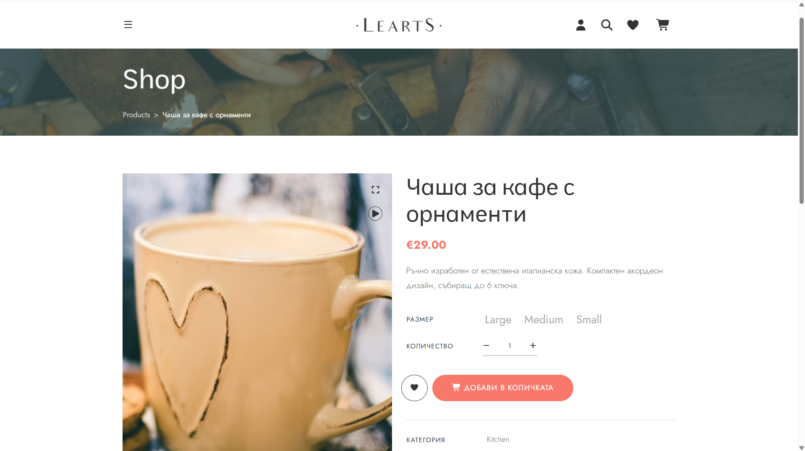
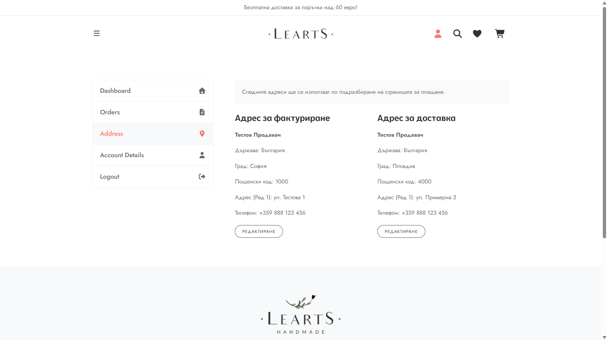

# Handmade Store

An online store for handmade products, built as a multi-vendor-ready marketplace (in the spirit of Etsy) for the Bulgarian market. Every product belongs to a vendor account, and user accounts carry a vendor status, so independent makers can be onboarded on top of the existing data model without restructuring it.

## Tech stack

**Backend** - [`handmade-backend/`](./handmade-backend)

- Node.js (ES modules) + Express 5.2
- MongoDB + Mongoose 9.6
- JSON Web Tokens (`jsonwebtoken` 9) stored in an httpOnly cookie (`cookie-parser`)
- `bcrypt` 6 for password hashing
- `cors`, `dotenv` 17

**Frontend** - [`handmade-store/`](./handmade-store)

- React 19.1 + Vite 7
- React Router 7
- Context API for global state
- react-bootstrap 2, Font Awesome 7, react-slick, yet-another-react-lightbox, react-countdown
- Vitest 4 + Testing Library (React 16) + jsdom

## Features

- **Product catalog** with filtering by category, tag (new / sale / hit) and maximum price, and sorting by price. All filters are kept in the URL query string.
- **Search** in an off-canvas panel: matches product titles, with an optional exact category filter. Debounced, up to 6 results, and the input is escaped before it is used in a regular expression.
- **Product details page** with an image gallery, a lightbox and a quantity selector.
- **Quick view** modal that opens a product from any listing.
- **Home page sections**: a hero slider with featured products, "Deal of the day" (the most discounted products, with a countdown) and the latest products by category.
- **Wishlist** saved in the browser (`localStorage`).
- **Shopping cart** saved in the browser. Stock and prices are checked against the API (`POST /products/check`) before an item is added and whenever the cart changes.
- **Authentication**: register, log in, log out with server-side token revocation, and restore the session on page load (`GET /users/me`). The JWT is kept in an httpOnly cookie.
- **Route guards**: `ProtectedRoute` for the account area and `PublicOnlyRoute` for the login/register page.
- **Account area**: a dashboard greeting, address management (add and edit, up to 2 addresses, the first one becomes the default), profile editing (full name, username) and password change with a current-password check. When the full name or an address is missing, the dashboard shows a reminder and the Address / Account Details tabs are marked.
- **Shared API layer** (`apiClient`, `useQuery`, `useMutation`) with Vitest unit tests.
- Lazy-loaded routes and an error boundary with a retry action.

## Getting started

### Requirements

- [Node.js](https://nodejs.org/) 20.19+ (required by Vite 7 and Mongoose 9)
- [MongoDB](https://www.mongodb.com/try/download/community) running locally on `mongodb://localhost:27017` (the `handmade-shop` database is created automatically)

### Environment variables

Each package has a `.env.example`. Copy it to `.env` and fill in the values.

#### `handmade-backend/.env`

| Variable | Required | Description |
| --- | --- | --- |
| `JWT_SECRET` | Yes | Secret used to sign and verify JWT auth tokens - a long random string. |
| `MONGODB_URI` | For `npm run seed` | MongoDB connection string used by the seed script, e.g. `mongodb://localhost:27017/handmade-shop`. |
| `NODE_ENV` | No | `development` or `production`. In `production` the auth cookie is sent only over HTTPS (`secure` flag), and the seed script refuses to run. |

Generate a value for `JWT_SECRET` with:

```bash
node -e "console.log(require('crypto').randomBytes(32).toString('hex'))"
```

#### `handmade-store/.env`

| Variable | Required | Description |
| --- | --- | --- |
| `VITE_API_BASE_URL` | No | Base URL of the backend API, without a trailing slash (default: `http://localhost:5000`). |

### Backend

```bash
cd handmade-backend
npm install
cp .env.example .env   # then set JWT_SECRET
npm run seed           # optional: sample users and products
npm run dev            # or: npm start
```

The API runs on **http://localhost:5000**.

`npm run seed` deletes **all** products and the seed users (any other registered users are kept). It then creates an admin, an approved vendor and a customer account, plus the sample products. The seed accounts and their password are printed to the console.

### Frontend

```bash
cd handmade-store
npm install
cp .env.example .env
npm run dev
```

The app runs on **http://localhost:5173**. The backend only accepts CORS requests from this origin.

### Tests

```bash
cd handmade-store
npm test          # watch mode
npm run test:run  # single run
```

## Project structure

```
handmadeStore/
├── handmade-backend/
│   └── src/
│       ├── controllers/   # Express routers (products, users)
│       ├── middlewares/   # verifyToken, errorHandler
│       ├── models/        # Mongoose schemas
│       ├── services/      # database logic used by the controllers
│       ├── utils/         # token, DTOs, slug helpers
│       ├── data/          # seed data
│       ├── index.js       # app entry point
│       ├── routes.js      # router composition
│       └── seed.js        # database seeder
├── handmade-store/
│   └── src/
│       ├── components/    # layout (header, footer), common, sections
│       ├── context/       # Auth, Shop (cart), Wishlist, QuickView
│       ├── hooks/         # useQuery, useMutation, useForm, ... (+ tests)
│       ├── pages/         # Home, Products, Product, Auth, Account
│       ├── routes/        # ProtectedRoute, PublicOnlyRoute
│       └── utils/         # apiClient, endpoints, constants
├── docs/screenshots/
├── ARCHITECTURE.md
└── README.md
```

## Architecture

Two independent packages: a React SPA that talks to an Express REST API over HTTP with cookie-based JWT authentication. See [ARCHITECTURE.md](./ARCHITECTURE.md) for the data model, auth flow and design decisions.

### Authentication and logout

- Login and registration issue a JWT (1 hour) with payload `{ _id, role }` and a unique `jti` (`randomUUID`), stored in the httpOnly `token` cookie.
- `POST /users/logout` (no valid token required) clears the cookie and revokes the token with `revokeToken`: its `jti` is saved in the `revoked_tokens` collection (a denylist) together with `expiresAt` = the token's `exp`. It returns `200 { message, isLoggedIn: false }`.
- `verifyToken` first runs `jwt.verify`, then rejects tokens whose `jti` is missing or listed in `revoked_tokens` with `401 "Session is no longer valid."`. A database error goes to `next(err)` and becomes a 500.
- On the frontend `onLogout` calls `POST /users/logout` and clears `localStorage` in `finally`, so the user is logged out locally even if the server does not respond.
- A TTL index on `expiresAt` (`expireAfterSeconds: 0`) removes revoked entries automatically once the token would have expired, so the denylist does not grow.
- Tokens issued before `jti` was introduced are rejected, so every user has to log in again once.
- Mongoose builds the index automatically in development. If production runs with `autoIndex: false`, create the `expiresAt_1` TTL index (`expireAfterSeconds: 0`) on `revoked_tokens` manually on deploy.

## Roadmap

- Checkout flow (cart → address → order) and order history in the account area
- Vendor onboarding: a "become a vendor" application flow
- Admin approval of vendor applications
- Vendor dashboard for managing products

## Screenshots




